<h1 align="center">Ocasio</h1>

<p align="center">
  <strong>An event-vendor marketplace for India: discover venues, caterers, photographers and decorators, request a booking, pay, and review the work.</strong>
</p>

<p align="center">
  <a href="LICENSE"></a>
</p>

<p align="center">
  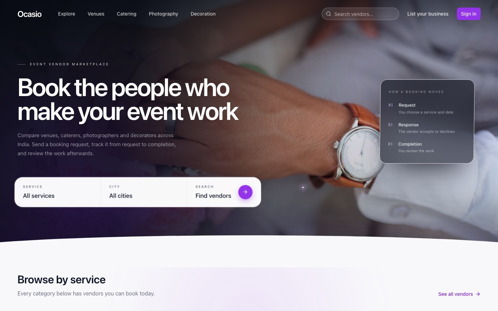
</p>

Ocasio is a full-stack marketplace built on React and Supabase. The interesting part is not the UI:
**the rules that matter are enforced in the database** — who owns a booking, what it costs, whether
a vendor has room on a date, whether a payment settled, who may refund it, whether a review is
allowed. Row Level Security covers every table, money moves only on a signed webhook, and 458 tests
run against real Postgres, including concurrency tests that hold real transactions open.

> **Read this before evaluating it**
>
> - **No live demo.** Ocasio is not deployed yet.
> - **The catalogue is sample data:** 40 invented vendors whose sample ratings are labelled as such.
> - **Razorpay is integrated but not activated.** Orders, Checkout, signed webhooks and refunds are
>   built and tested against a stand-in for Razorpay's API. Until an account is configured
>   ([deployment guide §6](docs/OCASIO_DEPLOYMENT.md#6-razorpay)) the site uses a test adapter and
>   **no money moves**.
> - **The legal pages are unreviewed drafts**, and they say so on the page.

---

## Contents

[Features](#features) · [Customer workflow](#customer-workflow) · [Vendor workflow](#vendor-workflow) ·
[Payments](#payment-architecture) · [Capacity](#vendor-capacity-management) ·
[Stack](#technology-stack) · [Architecture](#system-architecture) · [Repository](#repository-structure) ·
[Getting started](#getting-started) · [Testing](#testing) · [CI/CD](#cicd) · [Security](#security) ·
[Deployment](#deployment) · [Limitations](#known-limitations) · [Roadmap](#roadmap) ·
[Contributing](#contributing) · [License](#license)

---

## Features

- **Marketplace:** full-text and fuzzy search (Postgres FTS and `pg_trgm`), filters by category,
  city, price and rating, shareable URLs, saved vendors.
- **Booking requests** with a lifecycle the database enforces, and an immutable status history.
- **Daily vendor capacity.** A venue that hosts one event a day cannot be double-booked, even by two
  acceptances at the same instant.
- **Razorpay payments:** server-created orders, Razorpay Checkout, HMAC-verified webhooks and
  idempotent refunds. The browser never states an amount and never marks anything paid.
- **Vendor workspace:** profile, services and prices, portfolio uploads, booking management, refunds.
- **Moderation.** An admin reviews each vendor application before the listing goes live.
- **Reviews** come only from customers whose booking was completed, and ratings are recomputed by
  trigger.
- **Production groundwork:** a strict Content-Security-Policy and security headers, legal pages, and
  a CI pipeline that rebuilds the database from zero on every run.

---

## Customer workflow

| Find a vendor | See what they offer |
|---|---|
| 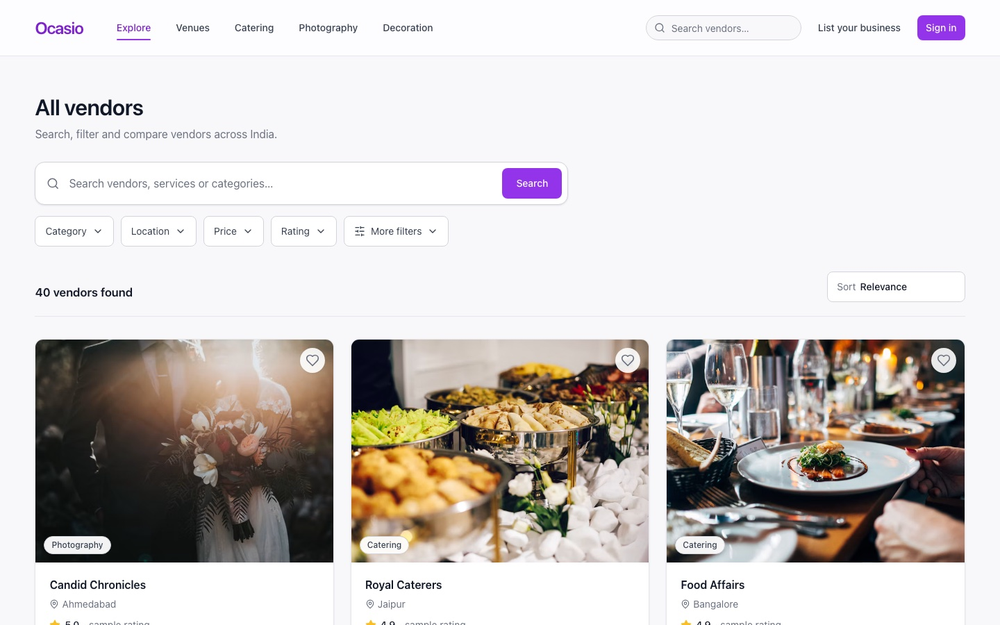 | 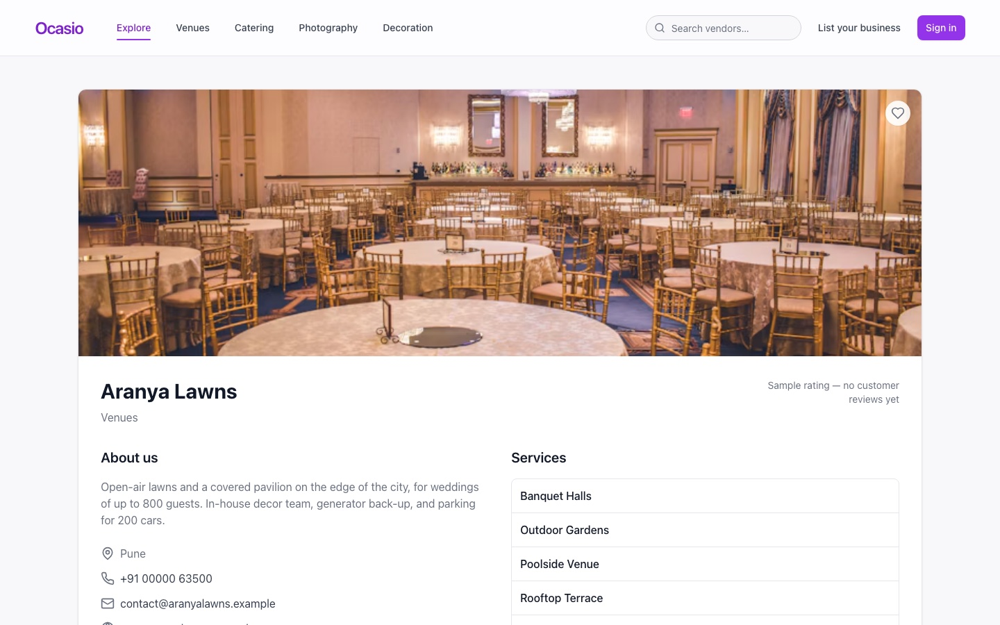 |

| Request a booking | Track it, and pay once it is accepted |
|---|---|
| 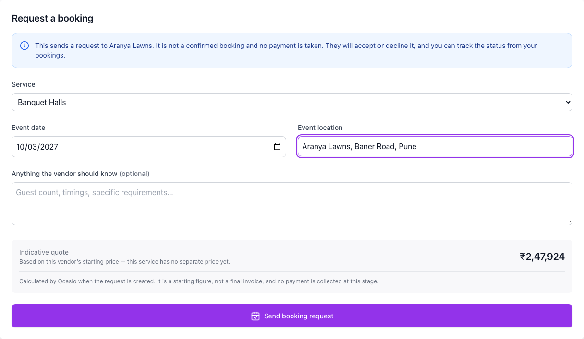 | 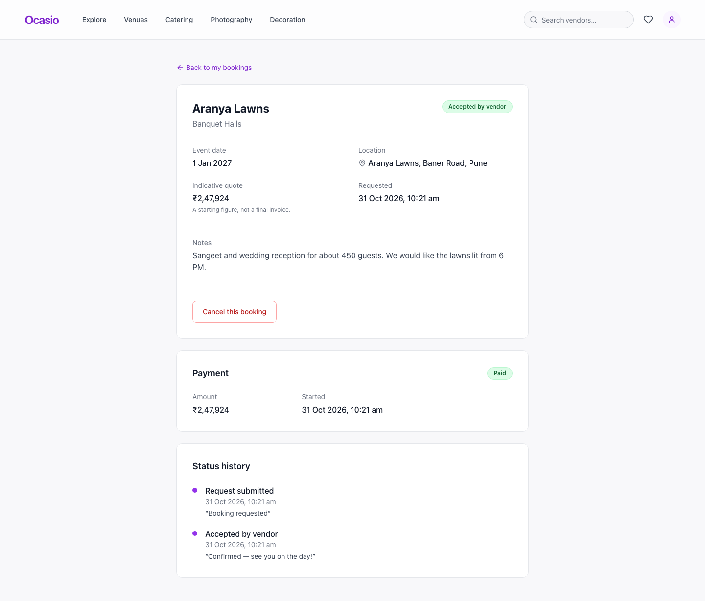 |

1. **Discover:** search and filter vendors, and save the ones worth comparing.
2. **Request:** choose a service, a date and a location. The database calculates the quote from the
   vendor's published price. A request is not a reservation.
3. **Track:** the booking page shows every status change and who made it.
4. **Pay:** once the vendor accepts, pay through Razorpay Checkout. The booking reads *Paid* only
   after Razorpay's signed webhook has confirmed the capture.
5. **Review:** available once the vendor has marked the event completed.

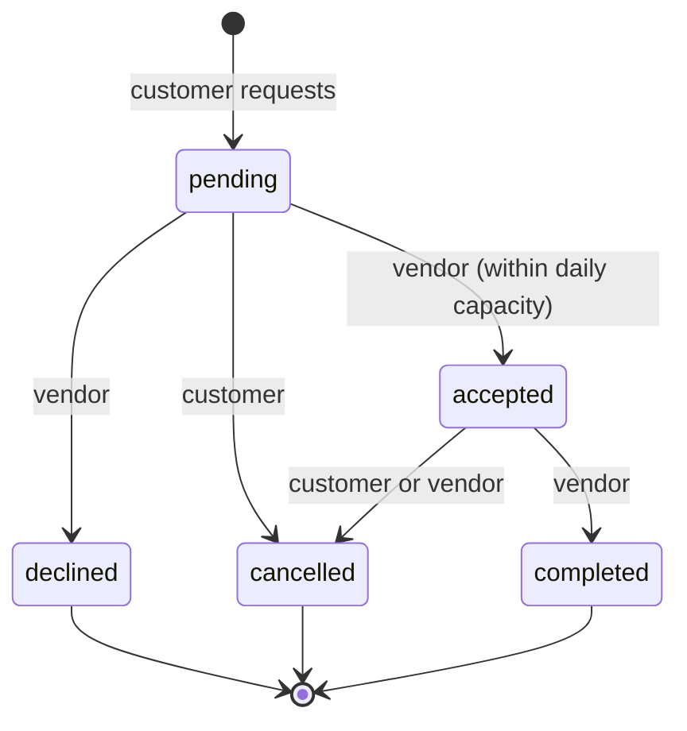

Every transition goes through `transition_booking_status()`, which locks the row and answers
*"Booking not found"* for someone else's booking, the same answer as for one that does not exist.

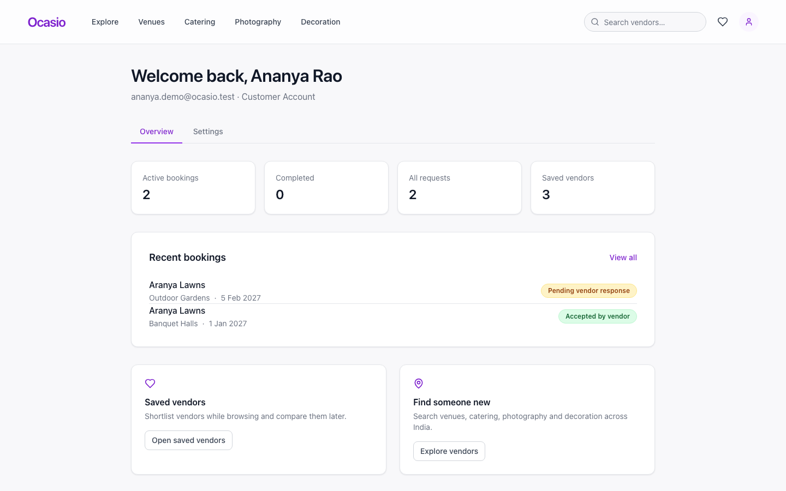

---

## Vendor workflow

| Dashboard | Booking requests, with the daily limit enforced |
|---|---|
| 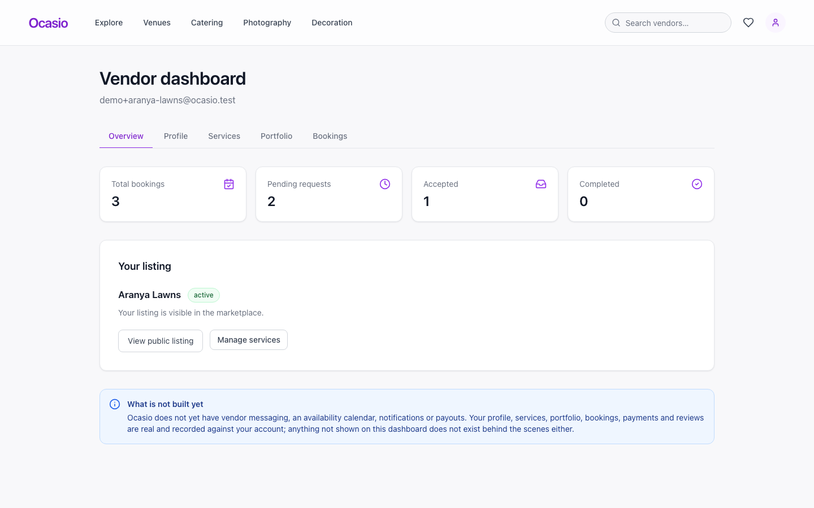 | 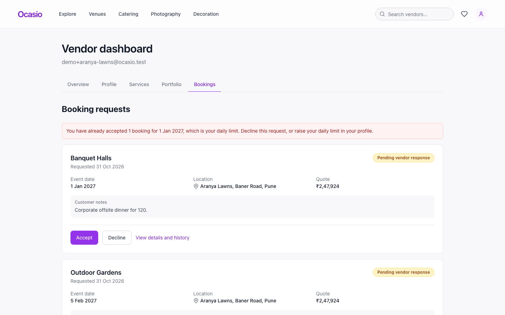 |

1. **Apply** to list a business. An admin reviews the application, and approval grants the vendor
   role.
2. **Set up** the profile, services and prices, portfolio photographs and **bookings per day**.
3. **Respond** to requests: accept, decline or mark completed, and cancel when you must.
4. **Refund** a paid booking in full or in part. The refund completes when Razorpay confirms it.

| Daily capacity setting | Admin: vendor applications |
|---|---|
| 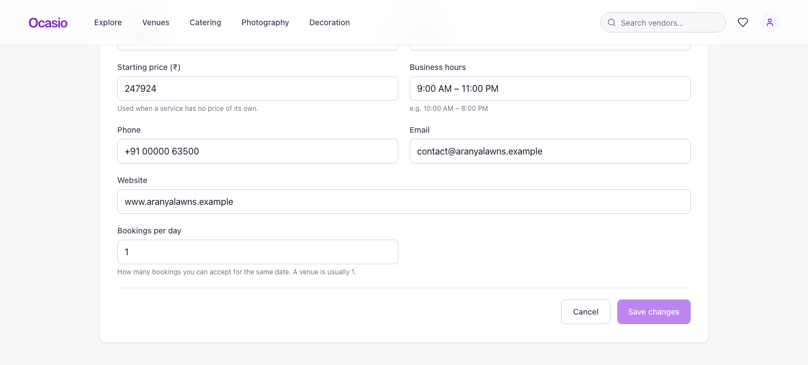 | 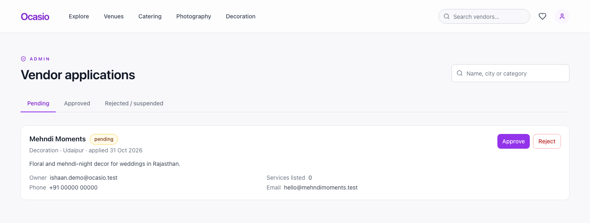 |

The app has no way to become an admin. An operator sets `profiles.role = 'admin'` with the service
role.

### On a phone

<p>
  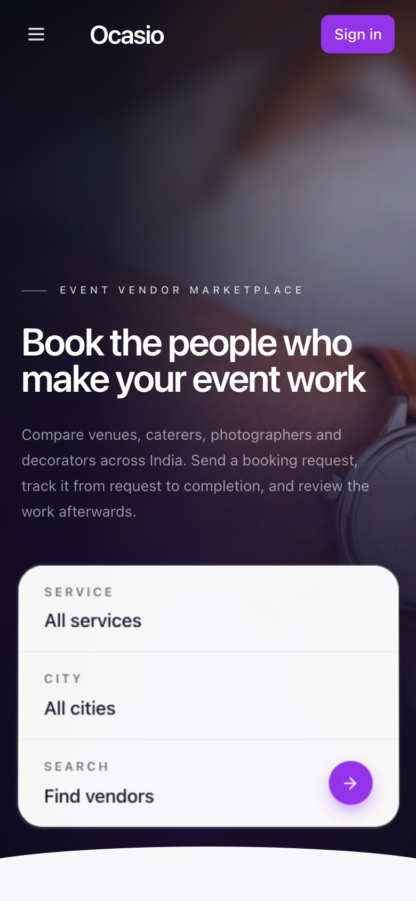
  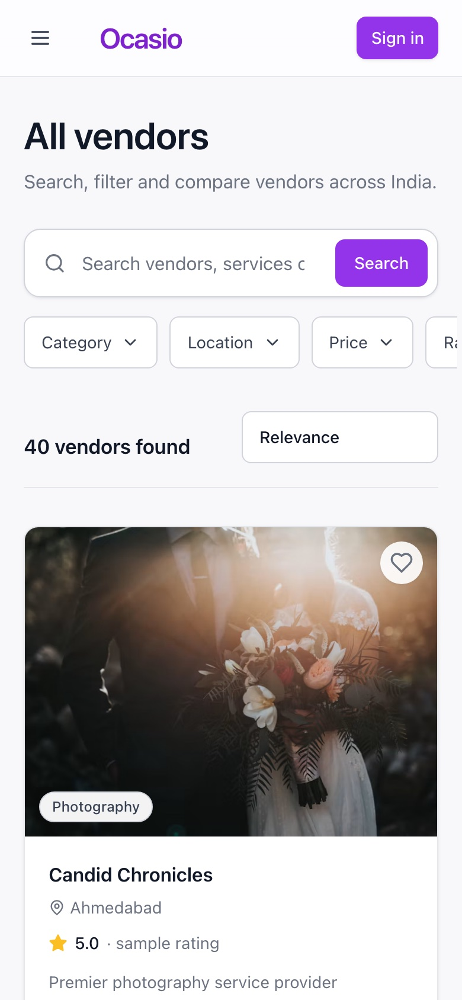
  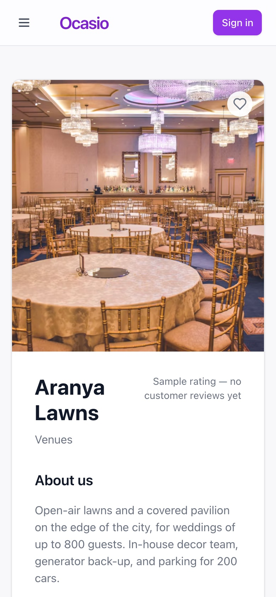
</p>

These screenshots show the production build running locally against a freshly migrated database,
signed in as invented demo accounts. Razorpay Checkout itself is not shown, because it needs a
Razorpay account's Test mode keys. The paid booking above went through the test adapter and was
settled the way the webhook settles a payment: a service-role call to the payment-event function.

---

## Payment architecture

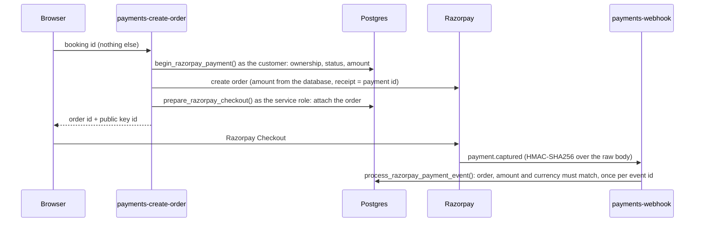

- **One order per booking**, enforced by a unique index. Retries reopen it, so a booking cannot be
  charged through two orders.
- **Only a verified webhook settles money.** Checkout's success callback shows "waiting for
  confirmation". Duplicate and out-of-order deliveries change nothing.
- **Refunds** reserve their amount while pending and pass the refund's id to Razorpay as the receipt,
  so a retried request cannot refund twice. They complete only on `refund.processed`.
- **No card data** ever reaches Ocasio, because Checkout runs in Razorpay's frame.

Payment states: `pending → processing → succeeded → partially_refunded / refunded`, with `failed` and
`cancelled` on the way. Only the signed webhook path, granted to `service_role` alone, reaches
`succeeded`. Details are in [docs/OCASIO_PAYMENTS.md](docs/OCASIO_PAYMENTS.md#14-razorpay) §14.

---

## Vendor capacity management

Each vendor sets **bookings per day**, from 1 to 100 (default 1). Accepting a booking counts the
vendor's accepted and completed bookings for that date **in the same transaction, under a lock on
the vendor row**, so two simultaneous acceptances cannot both take the last slot. Declining or
cancelling frees a slot, and pending requests use none.

A test holds one acceptance open in a real transaction, shows the second waiting on the lock, and
then shows it refused. Details are in [docs/OCASIO_BOOKINGS.md](docs/OCASIO_BOOKINGS.md).

---

## Technology stack

| Layer | Choice |
|---|---|
| Frontend | React 18, TypeScript (strict), Vite, React Router 6, Tailwind CSS |
| Backend | Supabase: Postgres 17, Auth, PostgREST, Storage, Edge Functions (Deno), `pg_cron` |
| Search | Postgres full-text search and `pg_trgm` |
| Payments | Razorpay: Orders, Standard Checkout, Refunds, webhooks |
| Hosting | Vercel (static), with security headers in `vercel.json` |
| Testing | Vitest (with `pg` for concurrency), Playwright (desktop and mobile) |
| CI | GitHub Actions: six jobs, SHA-pinned actions, gitleaks, dependency review |

---

## System architecture

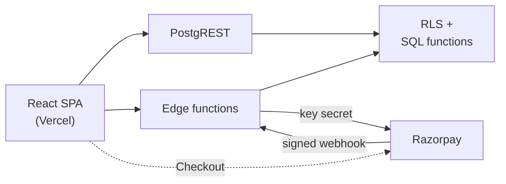

**The client supplies intent, never facts.** A booking request names a service, a date and a
location, never a customer, a price or a status. Tables that hold money or trust have read-only
policies, and every write goes through a function that re-derives authorization from the caller's
identity. [docs/ARCHITECTURE.md](docs/ARCHITECTURE.md) has the full map, the trust boundaries and the
testing layers.

---

## Repository structure

```
src/
├── pages/                 route components
├── components/            UI; design primitives in components/ui
├── services/              the only modules that call Supabase; payment adapters in services/payments
├── contexts/ hooks/ lib/  auth state, data hooks, env validation, site configuration
└── utils/dataGenerator.ts the deterministic demo catalogue behind supabase/seed.sql

supabase/
├── migrations/            14 migrations; the database is reproducible from these alone
├── functions/             payments-create-order, payments-refund, payments-webhook,
│                          payments-reconcile; shared handlers in _shared/
├── config.toml            local stack, auth policy, per-function JWT settings
└── seed.sql               demo catalogue; never run it against production

tests/                     Vitest: unit, integration (real Postgres), tests/edge (live functions)
e2e/                       Playwright specs, desktop and mobile
docs/                      architecture, domain, deployment, CI/CD and security documents
.github/workflows/ci.yml   CI
```

---

## Getting started

### Installation

**You need** Node 18 or later (CI uses 22), Docker, and a few GB of free disk for the Supabase
images.

```bash
git clone https://github.com/tanmaytyagii/Ocasio.git
cd Ocasio
npm install
```

### Environment variables

```bash
cp .env.local.example .env    # points the app at the local stack
```

The template holds Supabase's published local development keys, which are the same on every
machine and reach only a container on `127.0.0.1`. Anything prefixed `VITE_` is inlined into the
browser bundle and is **public**.

| Variable | Required | Notes |
|---|---|---|
| `VITE_SUPABASE_URL` | yes | Project URL |
| `VITE_SUPABASE_ANON_KEY` | yes | Public by design; safe only because RLS is on every table |
| `VITE_SUPPORT_EMAIL` | before launch | Shown on the contact and legal pages |
| `VITE_PAYMENT_PROVIDER` | no | `test` (default) or `razorpay` |

`npm run build` **fails** if a required variable is missing or invalid, so a misconfigured
deployment never ships. Server secrets (`RAZORPAY_KEY_ID`, `RAZORPAY_KEY_SECRET`,
`RAZORPAY_WEBHOOK_SECRET`) are set with `npx supabase secrets set` and never carry the `VITE_`
prefix. [.env.example](.env.example) lists every variable and where it is set.

### Supabase local setup

```bash
npx supabase start    # Postgres, Auth, PostgREST, Storage, Studio; applies every migration, then the seed
npm run dev           # http://localhost:5173
```

| Service | URL |
|---|---|
| App | http://localhost:5173 |
| Supabase API | http://127.0.0.1:54321 |
| Supabase Studio | http://127.0.0.1:54323 |

Each seeded vendor signs in as `demo+<slug>@ocasio.test` (for example `demo+aranya-lawns@ocasio.test`)
with the local-only password in `supabase/seed.sql`. Register a new account to act as a customer.

### Database migrations

The schema changes only through the migrations in `supabase/migrations/`, and they are append-only:
fix forward with a new migration and never edit one that has shipped.

```bash
npx supabase migration new <name>   # create
npm run db:reset                    # rebuild the local database from zero, then seed
npx supabase db lint --local        # plpgsql_check over every function
npx supabase db push                # apply to a linked hosted project
```

After changing `src/utils/dataGenerator.ts`, run `npm run db:seed:generate`.
`tests/seed-data.test.ts` fails when `seed.sql` and the generator disagree.

<details>
<summary>What each migration contains</summary>

| Migration | Contents |
|---|---|
| `20260919000001` | profiles, vendors, vendor services and media, favourites |
| `20260919000002` | database-backed roles, RLS policies, vendor onboarding |
| `20260919000003` | full-text search, filters, `search_vendors()` |
| `20260919000004` | bookings, status history, lifecycle functions |
| `20260919000005` | payments, refunds, payment events, audit log |
| `20260919000006` | reviews, rating aggregates, payment reconciliation |
| `20260919000007` | scheduled reconciliation, rating provenance |
| `20260919000008` | vendor moderation: `is_admin()`, moderation queue, `moderate_vendor()` |
| `20260919000009` | the `vendor-portfolio` storage bucket and its owner-only write policies |
| `20260919000010` | approving a vendor grants the vendor role |
| `20261030000001` | Razorpay: order ids, one payment per booking, verified webhook processing, server-side refunds with reserved amounts |
| `20261030000002` | vendor daily capacity, enforced on acceptance under a vendor-row lock |
| `20261031000001` | security hardening: table privileges, anonymous RPC access, pinned `search_path` |
| `20261031000002` | per-user request budgets for the payment functions (`consume_rate_limit()`) |

</details>

### Razorpay Test Mode

None of this is needed to run the app or the tests, which use the test adapter and a stand-in for
Razorpay's API.

1. In the Razorpay Dashboard, in **Test mode**, set payment capture to **automatic** and generate
   API keys.
2. Run `cp supabase/functions/.env.example supabase/functions/.env` and fill in the `rzp_test_…` key
   pair and a webhook secret. Never put Live mode keys on a development machine.
3. Run `npx supabase functions serve --env-file supabase/functions/.env`, then set
   `VITE_PAYMENT_PROVIDER=razorpay` in `.env`.
4. Razorpay cannot reach `localhost`. To receive webhooks, expose the functions through a tunnel and
   point a Test mode webhook at `<tunnel>/functions/v1/payments-webhook` with the events
   `payment.captured`, `payment.failed`, `refund.processed` and `refund.failed`.

Test cards and a full sandbox run are in
[docs/OCASIO_DEPLOYMENT.md](docs/OCASIO_DEPLOYMENT.md#64-sandbox-payment-testing) §6.4.

### Development commands

| Command | Does |
|---|---|
| `npm run dev` | Start the dev server |
| `npm run build` | Typecheck, then build for production |
| `npm run typecheck` | `tsc -b --force` |
| `npm run lint` | ESLint |
| `npm test` | Vitest unit and integration tests |
| `npm run test:edge` | Live edge-function tests (needs `supabase functions serve`) |
| `npm run test:e2e` | Playwright, desktop and mobile |
| `npm run db:reset` | Rebuild the local database from migrations and seed |
| `npm run db:seed:generate` | Regenerate `supabase/seed.sql` |

---

## Testing

```bash
npx supabase start
OCASIO_REQUIRE_SUPABASE=1 npm test   # 458 tests; fails instead of skipping if Supabase is down
npm run test:e2e                     # 168 runs: 84 tests on desktop and mobile
npm run test:edge                    # 14 live tests against the Deno functions (setup in docs/CI_CD.md)
DENO_NO_PACKAGE_JSON=1 npx deno@2 check supabase/functions/*/index.ts
```

- **Authorization is tested against real Postgres with real RLS.** Mocking Supabase would prove
  nothing about the thing that enforces access. The tests assert on rows, not on the absence of an
  error, because an update blocked by RLS matches zero rows and still reports success.
- **Concurrency is tested with real transactions.** The capacity and refund tests hold one
  transaction open and prove that the second waits on the lock.
- **Security rules are mutation-tested.** Each safeguard was weakened and the suite shown to fail
  ([the list](docs/SECURITY_AUDIT.md#mutation-testing)).
- **Playwright runs under the production CSP**, so a blocked script or image fails a test. Without a
  running stack the integration suites skip locally. CI sets `OCASIO_REQUIRE_SUPABASE=1`, so they
  can never skip there.

---

## CI/CD

Six jobs run on every pull request and every push to `main`:

1. typecheck, lint and build;
2. security: dependency audit, gitleaks and dependency review;
3. Deno type-check;
4. integration tests on a database rebuilt from zero;
5. the edge functions, live;
6. Playwright.

Actions are pinned to commit SHAs, the token is read-only, and no job needs a secret. Vercel deploys
the frontend, and a person applies database changes with `supabase db push`.
[docs/CI_CD.md](docs/CI_CD.md) covers each job, how to run it locally, and rollback.

> The workflow has been validated locally but has not run on GitHub yet. Its first run is the first
> push.

---

## Security

| Table | anon | customer | vendor owner |
|---|---|---|---|
| `vendors`, `vendor_services`, `vendor_media` | read active | read active | and manage their own |
| `reviews` | read (no author) | and create their own, through a function | no write |
| `profiles`, `favorites` | — | own only | own only |
| `bookings`, `payments`, `refunds` | — | own, read-only | own vendor's, read-only |
| `payment_events`, `audit_log` | — | — | — |

- **Roles** come from `profiles.role` alone. `user_metadata` is writable by its user and is never
  trusted.
- **No table holding money or trust has a write policy.** Writes go through functions, and a test
  keeps future migrations from adding such a policy.
- **Only a signature-verified webhook** can settle a payment or a refund. The reconciliation sweep
  accepts only the service-role key, and order and refund requests have per-user budgets.
- **Strict Content-Security-Policy:** no inline script and no framing; each build pins images and
  requests to its own Supabase project. There are no service-role
  keys, Razorpay secrets or webhook secrets in the repository, and gitleaks checks every change.
- **Never stored:** card numbers, CVV, bank credentials or provider secrets. A trigger rejects
  payment metadata carrying such keys.

The latest audit, with each finding's evidence and status, is in
[docs/SECURITY_AUDIT.md](docs/SECURITY_AUDIT.md). To report a vulnerability, see
[SECURITY.md](SECURITY.md).

---

## Deployment

Ocasio is not deployed yet. In order (the full checklist is in
[docs/OCASIO_DEPLOYMENT.md](docs/OCASIO_DEPLOYMENT.md)):

1. **Supabase:**
   - run `npx supabase link`, then `npx supabase db push`;
   - deploy the four functions, keeping JWT verification **off** for `payments-webhook` only;
   - set the secrets;
   - configure Auth: site URL, SMTP, email confirmation and 8-character passwords.

   **Never seed production.**
2. **Vercel:** import the repository and set the `VITE_*` variables separately for Preview and
   Production. `vercel.json` supplies the SPA rewrite and the security headers.
3. **Razorpay:** start in Test mode, then work through the production activation checklist
   ([§6.5](docs/OCASIO_DEPLOYMENT.md#65-production-activation-checklist)).

---

## Known limitations

- **Razorpay is not activated** and has never been exercised against Razorpay's servers.
- **No Razorpay reconciliation.** If a capture's webhook never arrives, someone has to check the
  Razorpay Dashboard. The existing sweep covers the test provider only.
- **No alerting** on audit events that need a person (for example a capture after cancellation, or
  a failed verification), or on a Razorpay webhook that keeps failing.
- **Not built yet:** messaging, notifications, a customer-facing availability calendar (customers can
  request a full date, and the vendor declines it), vendor payouts, disputes and chargebacks.
- **The admin console covers vendor moderation only.**
- **The legal pages are drafts.** The operating entity, address and grievance officer are not filled
  in (`src/lib/site.ts`).
- **Account deletion is blocked** for users with payment or review history
  ([docs/OCASIO_DATA_RETENTION.md](docs/OCASIO_DATA_RETENTION.md)).
- **Search is English-only** (the `english` text-search configuration).
- **Some dev-only dependencies** have advisories that only a major upgrade fixes. Nothing that ships
  to browsers is affected ([F-05](docs/SECURITY_AUDIT.md#findings)).

---

## Roadmap

1. Activate Razorpay in production, with a Razorpay reconciliation sweep and alerts on audit events.
2. Vendor payouts (Razorpay Route) and a dispute process.
3. Email notifications for requests, acceptances and payments.
4. Vendor availability that customers can see before they request a date.
5. Admin tools for refunds, disputes and review moderation.
6. Upgrade the Vite and Vitest toolchain.

---

## Contributing

See [CONTRIBUTING.md](CONTRIBUTING.md). These rules are not negotiable:

- the client supplies intent, never facts;
- never weaken RLS to make something render;
- money and trust tables get no write policies;
- never claim functionality that does not exist.

### Documentation

| Document | Covers |
|---|---|
| [ARCHITECTURE.md](docs/ARCHITECTURE.md) | System map, trust boundaries, testing layers |
| [OCASIO_DATABASE.md](docs/OCASIO_DATABASE.md) | Schema, roles, RLS philosophy, seed |
| [OCASIO_MARKETPLACE.md](docs/OCASIO_MARKETPLACE.md) | Search, filtering, pagination |
| [OCASIO_BOOKINGS.md](docs/OCASIO_BOOKINGS.md) | Booking lifecycle, pricing, daily capacity |
| [OCASIO_PAYMENTS.md](docs/OCASIO_PAYMENTS.md) | Payment state machine, webhooks, refunds, Razorpay |
| [OCASIO_REVIEWS.md](docs/OCASIO_REVIEWS.md) | Reviews, rating aggregates |
| [OCASIO_OPERATIONS.md](docs/OCASIO_OPERATIONS.md) | Running the reconciliation sweep |
| [OCASIO_DEPLOYMENT.md](docs/OCASIO_DEPLOYMENT.md) | Environments, Vercel, headers, Razorpay, launch checklist |
| [CI_CD.md](docs/CI_CD.md) | Pipeline, deployment, rollback |
| [SECURITY_AUDIT.md](docs/SECURITY_AUDIT.md) | Findings, evidence, residual risk |
| [OCASIO_DATA_RETENTION.md](docs/OCASIO_DATA_RETENTION.md) | Account deletion analysis |
| [OCASIO_PRODUCT_ROADMAP.md](docs/OCASIO_PRODUCT_ROADMAP.md) | Phase history |

---

## License

MIT. See [LICENSE](LICENSE).
