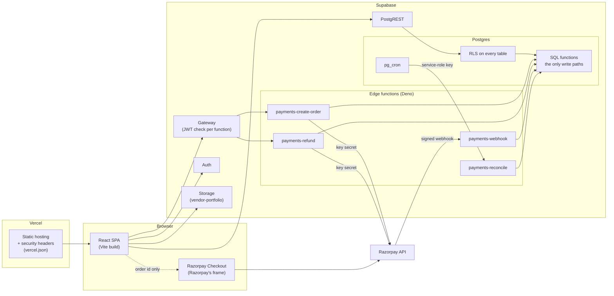

# Ocasio — Architecture

**Audience:** engineers new to the codebase. Detail lives in the domain documents linked below; this
is the map.

## The shape

## Trust boundaries

| Boundary | Rule | Enforced by |
|---|---|---|
| Browser → database | **The client supplies intent, never facts.** It names a service, a date, a booking — never a price, an owner, a status or an amount | `SECURITY DEFINER` functions that re-derive everything from `auth.uid()`; RLS with read-only policies on every money and trust table |
| Browser → payment functions | A bearer token identifies the user; Supabase Auth validates it | `supabase.auth.getUser(token)` in each function; ownership checks in SQL |
| Razorpay → webhook | Only a correctly signed body is believed | HMAC-SHA256 over the raw body, constant-time; `verify_jwt = false` for that one function |
| Scheduler → reconcile | Only the service-role key | Constant-time comparison in the function; the anon key — a valid JWT — is refused |
| Anyone → static site | No inline script, no framing, only listed origins | Content-Security-Policy and headers in `vercel.json`, exercised by every E2E test |

## Where each rule lives

| Concern | Lives in | Read |
|---|---|---|
| Roles, RLS, schema | `supabase/migrations/20260919000001_initial_schema.sql`, `supabase/migrations/20260919000002_roles_and_rls.sql`, `supabase/migrations/20261031000001_security_hardening.sql` | [OCASIO_DATABASE.md](./OCASIO_DATABASE.md) |
| Search and filtering | `search_vendors()` | [OCASIO_MARKETPLACE.md](./OCASIO_MARKETPLACE.md) |
| Booking lifecycle, daily capacity | `transition_booking_status()` | [OCASIO_BOOKINGS.md](./OCASIO_BOOKINGS.md) |
| Payments, refunds, Razorpay | `supabase/migrations/20261030000001_razorpay_payments.sql`, `supabase/functions/_shared/` | [OCASIO_PAYMENTS.md](./OCASIO_PAYMENTS.md#14-razorpay) §14 |
| Reviews, ratings, reconciliation | `create_review()`, rating triggers | [OCASIO_REVIEWS.md](./OCASIO_REVIEWS.md) |
| Headers, environments, Razorpay setup | `vercel.json`, `supabase/config.toml` | [OCASIO_DEPLOYMENT.md](./OCASIO_DEPLOYMENT.md) |
| CI and deployment flow | `.github/workflows/ci.yml` | [CI_CD.md](./CI_CD.md) |
| Security findings and residual risk | — | [SECURITY_AUDIT.md](./SECURITY_AUDIT.md) |

## Frontend

A single-page app (React 18, React Router 6, Tailwind). Pages under `src/pages`, route-level code
splitting in `src/App.tsx`; `src/services/*` are the only modules that talk to Supabase, and they
carry no authorization logic — the database decides, they report. Payment providers are adapters
(`src/services/payments/`): the `test` adapter for development, Razorpay Checkout in production,
chosen by `VITE_PAYMENT_PROVIDER`.

## Edge functions

Each function's `index.ts` only reads its environment and calls a handler in `_shared/`. The handlers
take their dependencies (database client factory, Razorpay client) as arguments, so the test suite
runs the exact same code in Node against the real database, with Razorpay replaced at the HTTP
boundary; `tests/edge/` then proves the deployed Deno entry points behind the gateway.

## Testing layers

| Layer | Tool | Against |
|---|---|---|
| Unit | Vitest | pure functions: signatures, parsing, return-path sanitising, seed rules |
| Integration | Vitest + `pg` | real Postgres, real RLS, real locks; concurrency with two open transactions |
| Live functions | Vitest | the Deno runtime behind Supabase's gateway |
| End to end | Playwright | the production build under the production CSP, desktop and mobile |
