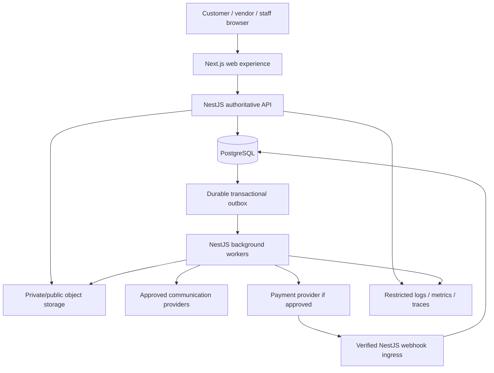

# 04 · Technical architecture and service contracts

Confirmed: Next.js frontend, NestJS backend; PostgreSQL when using SQL. Proposed: adopt PostgreSQL for the transactional domain, using a modular NestJS application with background workers. Other technology decisions remain proposals. No exact framework versions or hosting products are selected by this draft; verify supported releases and advisories when implementation begins.

## System shape

Public discovery can be cached. Transactional eligibility, authority, quote terms, money and capacity must be checked against authoritative records. Frontend server rendering does not make frontend-provided prices or permissions authoritative.

## Next.js responsibilities

Propose App Router with server-rendered public editorial/vendor/service pages and small client components for filters, comparison, brief builders and operational actions. Next.js officially supports this server/client composition ([documentation](https://nextjs.org/docs/app/getting-started/server-and-client-components)).

Next.js handles navigation, rendering, metadata, UI composition and session-aware API access. NestJS owns business rules. Optional Next.js route handlers/server actions may adapt requests, but must not create a second booking/pricing/permission implementation. Avoid direct frontend database writes that bypass the domain API.

Choose a same-origin API gateway/reverse-proxy arrangement or a carefully configured separate API origin after hosting/session review. Define cookie scope, CSRF protection where cookie authentication applies, CORS, trusted proxies and request size/time limits. Framework middleware and hidden buttons are not the only access boundary.

Cache published content with explicit invalidation on publication, moderation and withdrawal. Private responses use a deliberate non-shared caching policy. Availability displayed in a page is advisory until confirmation. Stable entity identifiers must survive title/slug changes, with approved redirects for public URLs.

## NestJS modules and ownership

| Module | Owns |
|---|---|
| Identity/access | Sessions/provider integration, membership, permissions, staff scopes |
| Supplier trust | Applications, evidence, admission, check scope/expiry, restrictions |
| Catalogue/coverage | Categories, services/packages, localities, eligibility and publishing |
| Content/media | Editorial ideas, provenance, rights, processing and publication |
| Occasion/brief | Customer context, versions, invitations and sharing |
| Discovery/matching | Search projections, eligibility filters and ranking explanation |
| Offers | Requests, recipients, quote versions, totals and expiry |
| Capacity | Resources, buffers, holds, commitments and release |
| Booking | Agreements, confirmation conditions, amendments and fulfilment |
| Finance | Conditional obligations, attempts, refunds, fees, settlements and reconciliation |
| Communication | Contextual messaging if approved; notification outbox and delivery |
| Support/reputation | Cases, remedies, completion evidence, review eligibility/moderation |
| Operations/audit | Scoped staff tooling, sensitive actions, records and reporting |

Use module contracts and database transactions rather than introducing microservices merely to appear production-grade. Split services later only with evidence of independent scaling, isolation or team ownership needs. Workers can be separately deployed while sharing domain code and contracts.

## Supporting technology proposals

| Need | Proposed baseline | Why / review point |
|---|---|---|
| Language | TypeScript across Next.js/NestJS | Shared vocabulary; runtime validation still required |
| Transactional store | PostgreSQL | Relationships, constraints, agreement versions and concurrency |
| Database access | Evaluate Prisma, Drizzle or explicit SQL | Prototype locking/transactions, migration control and query visibility before selecting |
| API contracts | REST with OpenAPI; generated client types | Explicit commands/errors and frontend/backend compatibility; NestJS supports OpenAPI tooling |
| Background work | PostgreSQL outbox plus retrying worker; evaluate BullMQ/Redis when queue needs justify it | Reliable notification/media/reconciliation work; Redis is not capacity authority |
| File storage | S3-compatible object storage plus CDN for approved public derivatives | Private evidence and public portfolio need different access paths |
| Search | PostgreSQL indexed text/filter queries initially; external search only if measured relevance/scale needs it | Avoid unnecessary search infrastructure; exclude private/unpublished records |
| Identity | Evaluate maintained identity system against approved sign-in/team/security needs | Do not invent home-grown recovery/credential storage unnecessarily |
| Messaging | Provider adapters after channel decision | Email/SMS/WhatsApp have different consent, templates, cost and delivery semantics |
| Payments | Provider abstraction after commercial feasibility and money-flow approval | Capability is not onboarding eligibility or approved business model |
| Observability | OpenTelemetry-compatible instrumentation; monitoring vendor to review | Correlate API, jobs and external operations without coupling domain logic to a vendor |
| Verification | Unit rules, PostgreSQL integration, API contract, browser E2E and accessibility tooling | Prove real workflows and failure handling |
| Deployment | Managed infrastructure candidates compared on cost, region, operations, backups and security | No automatic Vercel/AWS/other commitment |

NestJS [OpenAPI](https://docs.nestjs.com/openapi/introduction) and [queue documentation](https://docs.nestjs.com/techniques/queues) inform integration options; their existence does not establish the need for every component above.

## Illustrative API contracts

These are candidate resources/commands, not implementation-ready endpoint definitions. Final DTO fields, status codes, actor matrix and error catalogue follow approved workflows.

| Command/read | Principal server checks | Durable result |
|---|---|---|
| Read discovery/profile | Published eligibility, safe fields, validated filters/pagination | Public projection, freshness/availability semantics |
| Save/submit brief | Ownership/guest policy, category schema, version, share consent | Brief version and request/outbox records |
| Apply/update evidence | Business membership, upload scope, current application stage | Submission version, evidence links and reviewer task |
| Issue quote | Supplier ownership/eligibility, brief version, pricing/terms schema | Immutable issued version and notification event |
| Customer assent/request | Customer authority, exact offer version and terms | Agreed request pending vendor reconfirmation |
| Vendor accepts request | Vendor authority, exact customer-approved terms, eligibility, expiry and capacity | Confirmed booking and committed capacity without deposit; separate payment obligations |
| Initiate payment | Approved route, obligation, actor, amount/currency, operation identity | Attempt and provider creation/recovery references |
| Receive provider callback | Raw-body signature, provider identity, deduplication, correlated amount | Verified event plus reconciled domain effects |
| Propose/accept amendment | Agreement version, parties, approval authority, capacity, financial delta | Amendment and effective agreement version when eligible |
| Cancel booking | Actor, effective policy, concurrent state and financial obligations | Cancellation record, release and refund tasks as appropriate |
| Submit review/report issue | Eligibility/resource relationship, safe content, duplicate controls | Review/case plus audit/notification |
| Staff sensitive action | Scoped privilege, reason, approval limit, expected version | Auditable decision and separately tracked execution |

Command contract envelope: actor from verified session, request/correlation ID, operation key for effects, expected resource version and validated intent. Use consistent safe error codes such as `QUOTE_EXPIRED`, `VERSION_CONFLICT`, `CAPACITY_UNAVAILABLE`, `ACTION_FORBIDDEN`, `PAYMENT_STATUS_UNKNOWN`; wording must tell the user what can happen next without leaking internals.

Do not promise a general-purpose idempotency mechanism without defining key scope, request fingerprint, persisted response, retention and conflicting-payload behaviour. Never blindly retry payment creation with a new identifier after an ambiguous timeout.

## Transaction and asynchronous design

Vendor acceptance of a request for the last resource requires locks/constraints or an equivalent concurrency design. Lock order, deadlock/serialization retries, expiry checks and resource release must be defined and tested. [PostgreSQL locking documentation](https://www.postgresql.org/docs/current/explicit-locking.html) describes the underlying primitives; merely using transactions does not automatically prevent overbooking.

Persist business change plus outbox event atomically. Worker delivery is at least once: consumers must be idempotent. Track attempts, backoff, next retry, final failure and a staff-visible recovery action. Job payloads use identifiers rather than unnecessary personal data. Monitor expiry/reconciliation jobs; a scheduler that silently stops cannot be treated as operationally complete.

External provider calls happen outside long-running DB locks, with intent records and reconciliation for partial failure. Cache invalidation and search updates follow committed events. An accepted booking must remain accessible even when email or search projection updates fail.

## Security and privacy boundaries

Proposed baseline: deny by default; enforce resource/field permissions in every NestJS operation; scope staff by function and need; staff MFA; private evidence storage; upload size/type validation and quarantine; signed download URLs with access checks; secret management; rate limits and abuse protection; safe recovery/session revocation; restricted audit history. [OWASP authorisation guidance](https://cheatsheetseries.owasp.org/cheatsheets/Authorization_Cheat_Sheet.html) informs these proposals.

Create a data inventory recording purpose, collection point, access, disclosure, retention, deletion exceptions and provider processing. Do not put full addresses, identity evidence, credentials, payment secrets or private chat bodies in analytics/general logs. Public contact display, review attribution, guest access and privacy obligations remain decisions for review. Professional review must establish applicable legal/tax/data obligations; this document does not supply legal conclusions.

## Deployment and operations

Propose separate local, staging and production configurations with isolated credentials/data, repeatable migrations and seeded non-production examples clearly labelled. CI checks contracts, business tests, migration behaviour and full critical journeys. Secrets never ship in frontend builds.

Plan additive/backward-compatible database migrations before destructive cleanup; old and new application versions must coexist during deployment. Document rollback limitations for financial and schema changes. Feature flags disable unapproved/incomplete flows rather than exposing fake functionality.

Select backup cadence, point-in-time recovery, restore tests, recovery objectives, monitoring retention and incident coverage after D25. Record an accountable operator and runbook for payment mismatch, queue backlog, supplier outage, privacy/security incident and failed deployment. Availability percentages cannot be claimed without infrastructure and staffing evidence.

## Public visibility, accessibility and performance

Public pages need meaningful HTML, unique metadata, stable canonical links, sitemap inclusion rules and correct missing/removed-page handling. Avoid indexing every filter permutation or empty city/category combination. Private pages require authorisation; `noindex` is supplementary, not security. Structured data describes genuine visible content and is not a guarantee of search presentation. [Google JavaScript SEO guidance](https://developers.google.com/search/docs/crawling-indexing/javascript/javascript-seo-basics).

Proposed accessibility target: WCAG 2.2 AA, subject to review and testing. Proposed performance targets: good Core Web Vitals at p75, assessed on mobile and desktop—LCP ≤2.5s, INP ≤200ms, CLS ≤0.1. These are targets, not achieved results. Use lab checks before launch and field data when available. Sources: [W3C](https://www.w3.org/TR/WCAG22/), [Web Vitals](https://web.dev/articles/vitals).

## Explicit CSRF requirement · founder clarification, 23 November 2026

CSRF protection is confirmed as a security requirement. The exact mechanism follows the approved authentication/session topology. For cookie-authenticated mutations, propose a session-bound token strategy, verified request origin and secure cookie settings; SameSite is defence in depth rather than the sole universal protection. Do not use GET for state changes. CORS alone is not a complete CSRF defence.

Enforce protection on the authoritative NestJS mutation paths, including direct API access; a Next.js UI check alone is insufficient. Assess login, logout, account changes, booking acceptance/cancellation, refunds and vendor/staff actions. Missing/invalid tokens or untrusted origins must fail before effects. Safe same-site requests must still work, including expired-session recovery. Never put tokens in URLs/logs.

Payment webhooks use provider authentication/signatures, not browser CSRF tokens; any exemption must be narrow and documented. Recheck requirements if bearer credentials, cross-origin deployment or external identity flows are selected.

Acceptance evidence: simulated cross-site form submission cannot change state; missing/invalid/session-mismatched token rejected; stale session handled; legitimate flow succeeds; webhook signature tests remain independent. No protection is claimed implemented by this documentation update.

Sources: [OWASP CSRF prevention](https://cheatsheetseries.owasp.org/cheatsheets/Cross-Site_Request_Forgery_Prevention_Cheat_Sheet.html), [NestJS CSRF documentation](https://docs.nestjs.com/security/csrf).
